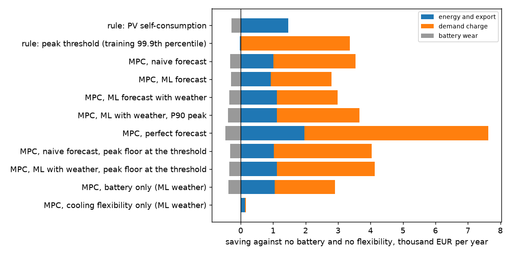
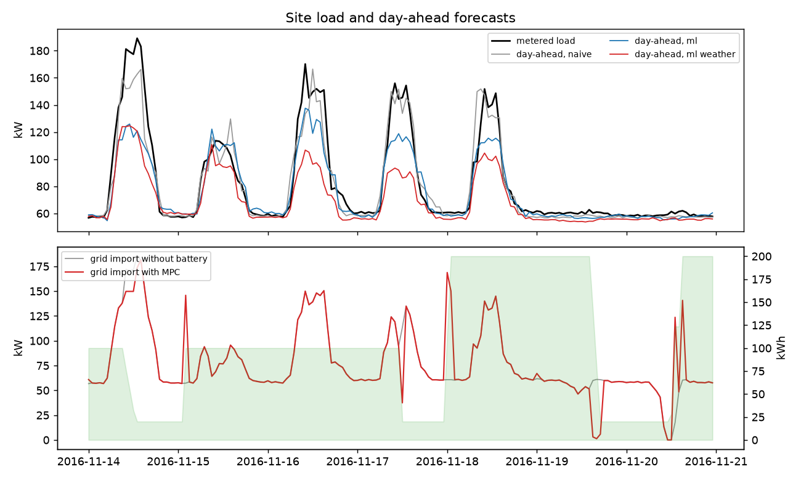

# de-site-energy-management

What is a load forecast worth to the energy management of an industrial site? A study on one year of metered
data from a small factory in Konstanz, Germany: day-ahead forecasts of load, cooling demand and PV; model
predictive control (MPC) of a battery, the cooling plant used as thermal storage and on-site PV, under day-ahead
prices and a German-style demand charge on the peak import.

Research study on public data. The site's load, cooling and PV profiles are metered; the battery, the PV size and
the tariff are assumptions stated below.

## Setup

- **Site.** `industrial3` of the Open Power System Data household data (CoSSMic project, Konstanz): grid import,
  PV and 17 sub-meters, hourly, February 2016 to June 2017. Mean load 82 kW, maximum 236 kW, lower on weekends;
  the chiller (cooling aggregate) draws up to 37 kW, mostly in summer.
- **Assets.** PV scaled from the metered roof and facade profile to 150 kWp (177 MWh in the test year, 1,180 kWh
  per kWp); battery 200 kWh / 100 kW, 90% round trip, 10% minimum charge; cold store of 40 kWh electric equivalent
  that lets the chiller run up to 40 kW ahead of the cooling demand (the same model describes a heat pump with a
  buffer tank).
- **Tariff.** Import at the day-ahead price (DE-AT-LU) plus 15 ct/kWh for grid fees, levies and taxes; export at
  the day-ahead price, PV curtailed at negative prices; demand charge 100 EUR per kW of the annual peak import
  (the German Leistungspreis for metered customers), with monthly peaks at 100/12 EUR per kW as a sensitivity;
  battery wear 3 ct per kWh discharged.
- **Test year.** 1 June 2016 to 31 May 2017 (8,760 hours). Everything before is training data only.

## Forecasts

Issued at noon of the day before, with measurements up to then (lags of at least 48 hours), refitted every month on
all earlier data (`src/siteems/forecast.py`):

| Forecast | Load MAE (kW) | Load RMSE | Daily peak MAE | Cooling MAE | PV MAE |
|---|---|---|---|---|---|
| Naive (same hour one week earlier; PV: mean of 7 days) | 16.2 | 26.7 | 28.1 | 4.6 | 9.0 |
| Gradient boosting, calendar and lags | 15.0 | 22.0 | 25.3 | 6.5 | 10.4 |
| Gradient boosting with weather (ERA5) | 13.3 | 20.8 | 25.9 | 3.2 | 6.5 |

Weather lowers the load error by 18% against the naive forecast and halves the PV and cooling errors without
weather. ERA5 is a reanalysis standing in for a numerical weather forecast, so the weather variant is optimistic.
A 90% quantile model is fitted alongside for the robust peak variant.

## Energy management

Every hour a linear program (SciPy, HiGHS) plans battery charge and discharge, chiller power, curtailment, import
and export to the end of the day, or to the end of the next day once its prices are known at 13:00, minimising
energy cost minus export revenue plus the demand charge on any rise of the peak plus battery wear. Only the first
hour is carried out with the real load; a local controller discharges further if the real import would pass the
planned peak, and the forecasts are corrected with the last observed error (`src/siteems/ems.py`).

## Results (annual demand charge, EUR per year)

The site without battery or flexibility pays 124,909 EUR (energy 105,173, demand charge 20,021 on a 200 kW peak).

| Strategy | Saving | Energy and export | Demand charge | Peak (kW) | Cycles |
|---|---|---|---|---|---|
| Rule: PV self-consumption | 1,184 | 1,471 | 0 | 200 | 48 |
| Rule: peak threshold at 167 kW | 3,326 | -29 | 3,365 | 167 | 2 |
| MPC, naive forecast | 3,220 | 1,016 | 2,522 | 175 | 53 |
| MPC, ML forecast | 2,505 | 928 | 1,878 | 181 | 50 |
| MPC, ML forecast with weather | 2,644 | 1,114 | 1,878 | 181 | 58 |
| MPC, ML with weather, P90 load in the peak constraint | 3,268 | 1,111 | 2,550 | 175 | 66 |
| MPC, naive forecast, peak floor at 167 kW | 3,716 | 1,023 | 3,013 | 170 | 53 |
| **MPC, ML with weather, peak floor at 167 kW** | **3,784** | 1,118 | 3,013 | 170 | 58 |
| MPC, perfect forecast (upper bound) | 7,150 | 1,966 | 5,660 | 144 | 79 |
| MPC, battery only (ML with weather) | 2,528 | 1,049 | 1,859 | 182 | 63 |
| MPC, cooling flexibility only (ML with weather) | 155 | 137 | 19 | 200 | |

Battery wear is included in the saving and not shown in the two middle columns. The threshold, 167 kW, is the 99.9th
percentile of the net load in the training months.



**Findings**

- **The demand charge is the money; the forecast error at the peak decides how much of it is kept.** With perfect
  foresight the battery lowers the annual peak from 200 to 144 kW and saves 7,150 EUR, 80% of it from the demand
  charge. Real forecasts keep 35% to 53% of that.
- **A better average forecast is not a better peak forecast.** The weather model has the lowest load error, but
  under the annual charge plain MPC with it saves less than with the naive forecast (2,644 against 3,220 EUR).
  Trained on squared error, gradient boosting smooths the high-load workdays (in mid-November 2016 it forecast 95 to
  125 kW for workdays that reached 150 to 190 kW), so the MPC spends the battery on peaks it underestimates and is empty
  when the largest one comes (14 November, 15:00, state of charge at the minimum). The daily peak error, 25 to 28 kW
  for all three forecasts, is the measure that matters, not the hourly MAE.
- **Keeping energy for the big peaks is worth more than forecast accuracy.** A plain threshold rule from the
  training data, which knows nothing about prices, matches the best plain MPC (3,326 EUR). Combining them, MPC for
  prices and PV plus a floor at the threshold under which the plan does not shave, gives the best result without
  perfect foresight: 3,784 EUR, 43% more than the same MPC without the floor. Planning the peak on the 90% load
  quantile instead of the mean gets most of the way there (3,268 EUR).
- **The chiller is too small to matter here.** Using the cooling plant as thermal storage saves 155 EUR a year:
  the chiller averages 6 kW against an 82 kW site and runs mainly in summer, while the costly peaks are on winter
  workdays.
- **Energy arbitrage is small at 2016 prices.** Shifting PV and cheap hours is worth about 1,000 to 2,000 EUR a
  year, because the fixed 15 ct/kWh dominates the import price and the day-ahead spread was narrow.

## Sensitivity: monthly demand charge

With twelve monthly peaks the result no longer hangs on one hour:

| Strategy | Saving (EUR per year) | Mean monthly peak (kW) |
|---|---|---|
| No battery, no flexibility | 0 | 171 |
| Rule: peak threshold at 167 kW | 986 | 161 |
| MPC, naive forecast | 2,923 | 148 |
| MPC, ML forecast | 3,052 | 146 |
| MPC, ML forecast with weather | 3,105 | 147 |
| MPC, ML with weather, P90 peak | 1,764 | 159 |
| MPC, perfect forecast | 6,585 | 117 |

Here the ranking follows forecast accuracy (weather > ML > naive), the fixed threshold is too high for most months,
and the P90 variant plans too cautiously. The best strategy depends on how the peak is billed: an annual charge
rewards reserving energy for the few largest peaks, a monthly charge rewards the better forecast every month.



## Limits

One site, one year, hourly resolution (a real demand charge is billed on 15-minute averages, which makes peaks
harder to shave). The battery, the PV size and the tariff are assumptions. ERA5 replaces a weather forecast, so the
weather variant is optimistic. Day-ahead prices for the next day are taken as known from 13:00, price forecasts are
not modelled. The cold store has no losses and the chiller's efficiency is constant. Batteries are modelled as a
linear program, without a binary to prevent simultaneous charge and discharge (negative prices are rare in the test
year). No intraday trading, grid services or battery ageing beyond a per-kWh wear cost.

## Data

- Open Power System Data, Household Data, version 2020-04-15, CC BY 4.0
  (https://doi.org/10.25832/household_data/2020-04-15).
- Day-ahead prices DE-AT-LU: Bundesnetzagentur | SMARD.de, CC BY 4.0, via api.energy-charts.info.
- Weather: ERA5 hourly reanalysis (Copernicus Climate Change Service) via the Open-Meteo archive API, CC BY 4.0.

Raw files are not in the repository; `scripts/download.py` fetches them.

## Run

```
python -m venv .venv
.venv/Scripts/pip install -e ".[test]"
.venv/Scripts/python scripts/download.py
.venv/Scripts/python -m siteems.run     # forecasts (about 7 minutes, cached in results/) and 19 one-year simulations
.venv/Scripts/python -m pytest -q
```
